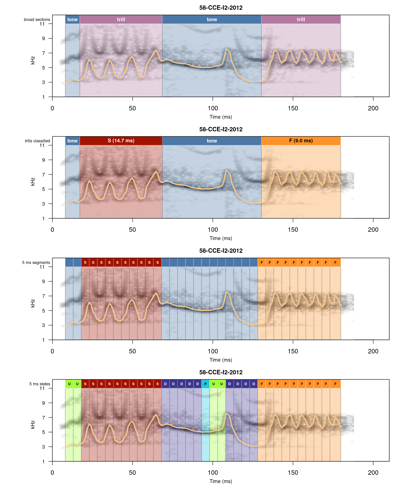

This site contains the analyses behind the manuscript on the cultural evolution of songs in long-billed hermit (*Phaethornis longirostris*) leks. Songs are coded as sequences of discrete sound states, which can then be aligned and used to study song evolution through time.

## Analysis reports

- **[Song segmenting](source/song_segment_coding_5ms.qmd)**: coding of songs as sequences of 5 ms segments with five possible states (two kinds of trills and three kinds of pure tones), agreement between copies of the same song type, and FASTA files for alignment

## Song segmenting at a glance

::: {.figure-gallery}

:::

## Reproducibility

All code and data are available in the [GitHub repository](https://github.com/maRce10/lbh_cultural_evolution_revBayes).
